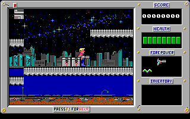

# Rigel Engine [](https://github.com/shimian5/RigelEngine/actions/workflows/ci.yml) [](https://discord.gg/QKYB6u4Kew)

## What is Rigel Engine?

RigelEngine is a modern C++ reimplementation of **Duke Nukem I** (1991) and
**Duke Nukem II** (1993), originally released by Apogee Software for MS-DOS.
It reads your original game files and runs natively on modern operating systems.
This fork builds on [lethal-guitar's RigelEngine](https://github.com/lethal-guitar/RigelEngine),
adding an independent Duke Nukem I implementation alongside the upstream Duke Nukem II engine.

Compared to running the originals in an emulator, RigelEngine offers modern enhancements
and usability improvements, including:

* widescreen rendering
* motion smoothing for scrolling and movement at higher display frame rates
* a shared, controller-friendly launcher and menus for both games
* an overlay HUD and improved game controller support
* persistent save slots, quick saves, level-start autosaves, and Continue for both games
* extended modding features for Duke Nukem II




*First: Duke Nukem II in RigelEngine. Second: Duke Nukem I DOS reference capture
from this project's development.*

The original games did not have publicly released source code. Their behaviour is studied
through reverse engineering of the DOS executables and comparison with the original games.
See [Duke2Reconstructed](https://github.com/lethal-guitar/Duke2Reconstructed) for the
Duke Nukem II reconstruction. The new Duke Nukem I implementation is developed from
the DOS executables, data and behavioural tests. Game files are supplied by the player;
no game data is included in builds.

Read the upstream [F.A.Q.](https://github.com/lethal-guitar/RigelEngine/wiki/FAQ).

## Current state

The upstream Duke Nukem II engine supports all four episodes, including shareware and
registered data. This fork adds a new launcher, menus and persistent saves around it.

Duke Nukem I supports the shareware episode and all three registered episodes, with
episode-aware campaign progression and level selection. It remains under active development
and playtesting; some presentation work, including animated endings, is incomplete.

### Supported platforms

RigelEngine supports Windows, Linux, macOS and **Android ARM64**.
The Android build targets Android 8.0 / API 26 or newer and uses OpenGL ES.
A controller is recommended for Android handhelds; a complete touch-control interface
is not currently provided.

It's also possible to [install on Steam Deck](https://github.com/lethal-guitar/RigelEngine/wiki/Steam-Deck-setup).

The Linux version supports small single-board computers such as Raspberry Pi.
See the upstream guide to [Running on Raspberry Pi and Odroid Go Advance](https://github.com/lethal-guitar/RigelEngine/wiki/Running-on-Raspberry-Pi-and-Odroid-Go-Advance).

### System requirements

RigelEngine is not very demanding, but it does require OpenGL-capable graphics hardware.
Either OpenGL 3.0 or OpenGL ES 2.0 can be chosen at compile time.

Any Nvidia or AMD graphics card from 2007 or later should run the game without problems.
Intel integrated GPUs only added OpenGL 3 support in 2011, however.
On Linux, using GL ES can be an option for those older Intel GPUs.

See [Supported Graphics cards](https://github.com/lethal-guitar/RigelEngine/wiki/Supported-graphics-cards-(GPUs)) for more info.

Upstream Duke Nukem II has modest hardware requirements, including support for older
Raspberry Pi systems. Those figures are not minimum requirements established for this fork's
Duke Nukem I implementation or Android build.

## Contributing

Contributions to RigelEngine are very welcome! Please have a look at the [contribution guide](CONTRIBUTING.md) before making a PR.

There is a growing body of documentation on the Wiki, to help with getting into the code base. A good place to start is [Architecture Overview](https://github.com/lethal-guitar/RigelEngine/wiki/Architecture-overview)

For work specific to this fork, see the [pull requests](https://github.com/shimian5/RigelEngine/pulls).

## Running RigelEngine

Supply your own original DOS game files. Shareware and registered versions are supported.
On first launch, select your Duke Nukem II installation in the file browser; the location
is saved in your user profile. You can also pass that directory on the command line.

**The current launcher requires Duke Nukem II data even when you want to play Duke Nukem I.**
Place Duke Nukem I's files in a directory named `DN1` inside or beside the selected
Duke Nukem II directory. The launcher also recognizes `DN1-full/pc` in either location,
and can recognize the selected directory itself if it contains both games' files.

For example:

```text
Games/
  Duke2/
    NUKEM2.CMP
    NUKEM2.F1       (optional intro movies, through .F5)
  DN1/
    DN1.EXE
    WORLDAL1.DN1
    ...            (all other episode 1 data files)
    DN2.EXE
    WORLDAL1.DN2
    ...            (all other episode 2 data files)
    DN3.EXE
    WORLDAL1.DN3
    ...            (all other episode 3 data files)
```

Select `Games/Duke2` when prompted. On Android, use an accessible location for these
directories and select it through the app's file browser.

### Acquiring the game data

Use an existing DOS installation or obtain the original shareware or registered release.
Upstream's [game-data instructions](https://github.com/lethal-guitar/RigelEngine/wiki/FAQ)
provide additional background for Duke Nukem II.

For **Duke Nukem II**, the required file is `NUKEM2.CMP`. Include `NUKEM2.F1` through
`NUKEM2.F5` for the optional intro movies; missing movies are skipped.
Existing original Duke Nukem II saves, high scores and settings can be imported into
RigelEngine's user profile on first use.

For **Duke Nukem I**, keep each episode's original EXE and all matching loose data files
together: `DN1.EXE` with `*.DN1`, `DN2.EXE` with `*.DN2`, and `DN3.EXE` with `*.DN3`.
Install only the episodes you own; filenames are case-insensitive. The episode EXE supplies
level order, backdrops and story text, so it is required as well as the data files.
The known incomplete shareware `DROP3.DN1` is supported with a visible compatibility warning;
a complete file loads normally.

### Launcher, menus and saves

The shared launcher lets you choose Duke Nukem I or Duke Nukem II, start a new game,
continue your most recent save, or load a saved game. Both games use controller-friendly
menus and an overlay HUD. In Duke Nukem I, New Game offers the installed episodes and
their main levels. Starting directly at a later level gives Duke default equipment.

Both games provide eight numbered save slots, a quick-save slot and a level-start autosave.
Use the pause menu to save or load; Continue resumes the latest save for the selected game.
Saves live in the application user profile, separately from your original game files.

Persistent saves record the starting state and your inputs, then reconstruct your progress
when loaded. Loading a long session can therefore take longer. Keep the matching game data;
compatibility across engine changes is not guaranteed.

### Command line options, debugging tools, more info

The upstream [Wiki](https://github.com/lethal-guitar/RigelEngine/wiki) covers Duke Nukem II's
command-line options, debugging tools and engine features. Details specific to this fork
are documented here and in the [Android build guide](android/README.md).

## Pre-built binaries

For this fork's Android build, open a successful run in
[GitHub Actions](https://github.com/shimian5/RigelEngine/actions/workflows/ci.yml)
and download the `android-arm64-apks` artifact. It contains a signed development APK,
an aligned unsigned APK for separate signing, checksums and source revision information.
A GitHub sign-in is required to download workflow artifacts.

CI uses a disposable debug signing key, so APKs from different runs may not update an
existing installation. See [Android signing and updates](android/README.md#signing-and-device-updates)
before updating an installation with saves you want to keep. These are development builds,
not signed release packages, and contain no game data.

The [upstream releases](https://github.com/lethal-guitar/RigelEngine/releases), upstream
[Flatpak](https://flathub.org/apps/details/io.github.lethal_guitar.RigelEngine) and
[third-party Linux packages](https://github.com/lethal-guitar/RigelEngine/wiki/Third-party-Linux-builds)
provide desktop builds of the upstream Duke Nukem II engine. They do not include this fork's
Duke Nukem I implementation, launcher or persistent-save additions.

## Building from source

Clone this fork with its submodules. On Linux or macOS, use a separate build directory:

```sh
git clone --recursive --branch dn1-snapshot-2026-10-26 https://github.com/shimian5/RigelEngine.git
cd RigelEngine
cmake -S . -B build-host -DCMAKE_BUILD_TYPE=Release -DCMAKE_POLICY_VERSION_MINIMUM=3.5 -DBUILD_TESTS=ON
cmake --build build-host --parallel 2
ctest --test-dir build-host --output-on-failure
```

Install the platform dependencies described in [BUILDING.md](BUILDING.md) first.
For Visual Studio, follow its Windows setup instructions and select the same configuration
when building and testing (for example, `--config Debug` and `--build-config Debug`).
The normal engine build includes both games. For Android, follow
[android/README.md](android/README.md) and run `bash tools/build_android.sh` from a Linux host
with the documented Java, SDK and NDK setup. No game files are needed to build.

### CI in this fork

Pushes, pull requests and manual runs of the [CI workflow](.github/workflows/ci.yml) check:

* Linux x86-64 and ARM64 builds and tests in Debug and Release
* Windows/MSVC x64 builds and tests in Debug
* macOS builds and tests in Debug and Release
* source formatting with clang-format 11
* Android ARM64 APK compilation, signing and package verification

Linux and macOS builds treat compiler warnings as errors. The native test suites include
Duke Nukem I core and frontend regressions alongside Duke Nukem II tests, using generated
fixtures without original game files. Additional standalone Duke Nukem I checks can be
configured with `cmake -S src/duke1 -B build-host-dn1 -DBUILD_TESTING=ON`; some optional
research checks require separately supplied DOS data or local probe traces.

Android CI uploads the APK artifact for 14 days and verifies its allowed contents and
native architecture. It does not launch the game or test device performance, controllers
or Android lifecycle behaviour; those require separate device testing.
