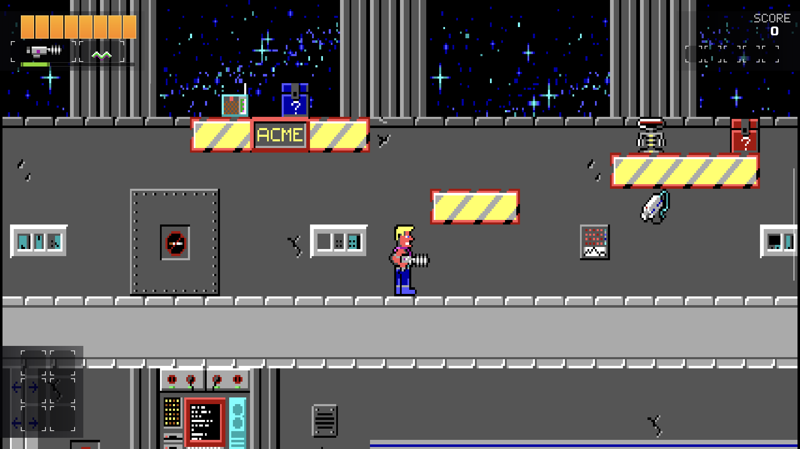
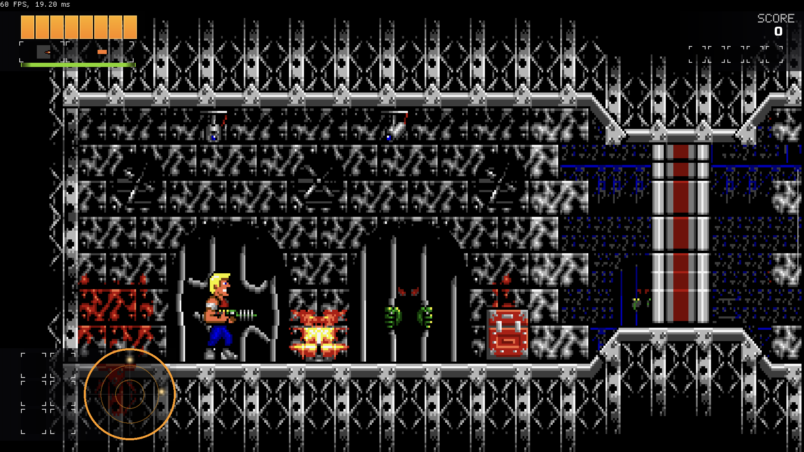

# RigelEngine: Proton [](https://github.com/shimian5/RigelEngine-Proton/actions/workflows/ci.yml)

## What is RigelEngine: Proton?

RigelEngine: Proton is an enhanced C++ reimplementation of **Duke Nukem I** (1991) and
**Duke Nukem II** (1993), originally released by Apogee Software for MS-DOS.
It reads your original game files and runs natively on modern operating systems.
This fork builds on [lethal-guitar's RigelEngine](https://github.com/lethal-guitar/RigelEngine),
adding an independent Duke Nukem I implementation alongside the upstream Duke Nukem II engine.

Compared to running the originals in an emulator, RigelEngine: Proton offers modern enhancements
and usability improvements, including:

* widescreen rendering
* motion smoothing for scrolling and movement at higher display frame rates
* a shared, controller-friendly launcher and menus for both games
* an overlay HUD and improved game controller support
* persistent save slots, quick saves, level-start autosaves, and Continue for both games
* extended modding features for Duke Nukem II



*Duke Nukem I with the modern overlay HUD (Retroid Pocket G2).*



*Duke Nukem II with the modern overlay HUD (Retroid Pocket G2).*

The original games did not have publicly released source code. Their behaviour is studied
through reverse engineering of the DOS executables and comparison with the original games.
The new Duke Nukem I implementation is developed from the DOS executables, data and
behavioural tests. For Duke Nukem II, see
[Duke2Reconstructed](https://github.com/lethal-guitar/Duke2Reconstructed). Game files are supplied by the player;
no game data is included in builds.

Read the upstream [F.A.Q.](https://github.com/lethal-guitar/RigelEngine/wiki/FAQ).

## Current state

Duke Nukem I supports the shareware episode and all three registered episodes, with
episode-aware campaign progression and level selection. It remains under active development
and playtesting; some presentation work, including animated endings, is incomplete.

The upstream Duke Nukem II engine supports all four episodes, including shareware and
registered data. This fork adds a new launcher, menus and persistent saves around it.

### Supported platforms

RigelEngine: Proton supports Windows, Linux and **Android ARM64**.
macOS is not supported by this fork: upstream's macOS support predates Apple silicon, it is
not built or tested here, and the new Duke Nukem I code has never been run on it.
The Android build targets Android 8.0 / API 26 or newer and uses OpenGL ES.
A controller is recommended for Android handhelds; a complete touch-control interface
is not currently provided.

It's also possible to [install on Steam Deck](https://github.com/lethal-guitar/RigelEngine/wiki/Steam-Deck-setup).

The Linux version supports small single-board computers such as Raspberry Pi.
See the upstream guide to [Running on Raspberry Pi and Odroid Go Advance](https://github.com/lethal-guitar/RigelEngine/wiki/Running-on-Raspberry-Pi-and-Odroid-Go-Advance).

### System requirements

RigelEngine: Proton is not very demanding, but it does require OpenGL-capable graphics hardware.
Either OpenGL 3.0 or OpenGL ES 2.0 can be chosen at compile time.

Any Nvidia or AMD graphics card from 2007 or later should run the game without problems.
Intel integrated GPUs only added OpenGL 3 support in 2011, however.
On Linux, using GL ES can be an option for those older Intel GPUs.

See [Supported Graphics cards](https://github.com/lethal-guitar/RigelEngine/wiki/Supported-graphics-cards-(GPUs)) for more info.

Minimum hardware requirements for this fork's Duke Nukem I implementation and Android
build have not been established. Duke Nukem II's upstream engine also supports older
Raspberry Pi systems.

## Contributing

Contributions to RigelEngine: Proton are welcome! Please have a look at the [contribution guide](CONTRIBUTING.md) before making a PR.

There is a growing body of documentation on the Wiki, to help with getting into the code base. A good place to start is [Architecture Overview](https://github.com/lethal-guitar/RigelEngine/wiki/Architecture-overview)

For work specific to this fork, see the [pull requests](https://github.com/shimian5/RigelEngine-Proton/pulls).

## Running RigelEngine: Proton

Supply your own original DOS game files. Duke Nukem I supports shareware episode 1 and
all three registered episodes; Duke Nukem II supports shareware and registered data.

You only need the files for the game or games you want to play. Duke Nukem I does not
need any Duke Nukem II data, and Duke Nukem II does not need Duke Nukem I's. If a game's
files are missing, its entry in the launcher is greyed out.

Put each game in its own folder and select one folder at first launch (or later via
Options > Choose game data folder). A simple layout:

```text
Games/
  Duke1/
    DN1.EXE         (Duke Nukem I episode 1 program)
    WORLDAL1.DN1    (episode 1 data, and so on)
    DN2.EXE         (Duke Nukem I episode 2 program)
    WORLDAL1.DN2
    DN3.EXE         (Duke Nukem I episode 3 program)
    WORLDAL1.DN3
    ...
  Duke2/
    NUKEM2.CMP
    NUKEM2.F1       (optional intro movies, through .F5)
```

Note that `DN1.EXE`, `DN2.EXE` and `DN3.EXE` are the three *episodes of Duke Nukem I*; they
have nothing to do with Duke Nukem II, which uses `NUKEM2.CMP`.

* **Both games:** select `Games/Duke2`. The launcher finds `Duke1` next to it.
* **Duke Nukem I only:** select `Games/Duke1`.
* **Duke Nukem II only:** select `Games/Duke2`.

The launcher looks for the Duke Nukem I files in a folder named `Duke1` or `DN1`, inside
the selected folder or next to it, and also in the selected folder itself. Without Duke
Nukem II's data there is no Duke Nukem II menu music, since Duke Nukem I's level songs are
borrowed from it; Duke Nukem I's own sound effects are unaffected. The selected path is
saved in your user profile. Desktop builds also accept it on the command line. On Android,
store the files in a location accessible to the app.

### Acquiring the game data

Use an existing DOS installation or obtain the original shareware or registered release.
For **Duke Nukem I**, keep each episode's original EXE and all matching loose data files
together: `DN1.EXE` with `*.DN1`, `DN2.EXE` with `*.DN2`, and `DN3.EXE` with `*.DN3`.
Install only the episodes you own; filenames are case-insensitive. The episode EXE supplies
level order, backdrops and story text, so it is required as well as the data files.
The known incomplete shareware `DROP3.DN1` is supported with a visible compatibility warning;
a complete file loads normally.

For **Duke Nukem II** (needed only if you want to play it), the required file is `NUKEM2.CMP`. Include `NUKEM2.F1` through
`NUKEM2.F5` for the optional intro movies; missing movies are skipped.
Existing original Duke Nukem II saves, high scores and settings can be imported into
RigelEngine: Proton's user profile on first use. The upstream
[F.A.Q.](https://github.com/lethal-guitar/RigelEngine/wiki/FAQ) provides additional
background for Duke Nukem II.

### Launcher, menus and saves

The shared launcher lets you choose Duke Nukem I or Duke Nukem II (whichever you have files for), start a new game,
continue your most recent save, or load a saved game. Both games use controller-friendly
menus and an overlay HUD. In Duke Nukem I, New Game offers the installed episodes and
their main levels. Starting directly at a later level gives Duke default equipment.

Both games provide eight numbered save slots, a quick-save slot and a level-start autosave.
Use the pause menu to save or load; Continue resumes the latest save for the selected game.
Saves live in the application user profile, separately from your original game files.

Both games use the keyboard bindings from the Options menu (arrow keys, Ctrl to jump and Alt to
fire by default, F5 quick save, F7 quick load). Duke Nukem I also accepts Space or Z to jump and X to fire.

Persistent saves record the starting state and your inputs, then reconstruct your progress
when loaded. Loading a long session can therefore take longer. Keep the matching game data;
compatibility across engine changes is not guaranteed.

### Command line options, debugging tools, more info

Duke Nukem I setup and the shared launcher and saves are documented above. For Android,
see the [build guide](android/README.md). The upstream
[Wiki](https://github.com/lethal-guitar/RigelEngine/wiki) covers Duke Nukem II's
command-line options, debugging tools and engine features.

## Pre-built binaries

Download public builds from [Proton Releases](https://github.com/shimian5/RigelEngine-Proton/releases):
Android ARM64 APK, Windows x64 ZIP, and Linux x64/ARM64 packages. Prereleases are
labelled as test versions. Players supply their own original game files.

Android release APKs use a permanent signing identity so later releases can update
in place while preserving saves/settings. Development APKs from
[GitHub Actions](https://github.com/shimian5/RigelEngine-Proton/actions/workflows/ci.yml)
use disposable test keys; do not use those to update an existing release installation.
See [Android signing and updates](android/README.md#signing-and-device-updates).

Windows packages include SDL dependencies; install the Microsoft Visual C++ 2015–2022
Redistributable (x64) if needed. Linux packages are built on Ubuntu 24.04 and require
compatible system libraries; the tar archive does not bundle those libraries.

The [upstream releases](https://github.com/lethal-guitar/RigelEngine/releases), upstream
[Flatpak](https://flathub.org/apps/details/io.github.lethal_guitar.RigelEngine) and
[third-party Linux packages](https://github.com/lethal-guitar/RigelEngine/wiki/Third-party-Linux-builds)
do not include this fork's Duke Nukem I implementation, launcher or persistent-save
additions; they provide desktop builds of the upstream Duke Nukem II engine.

## Building from source

Clone this fork with its submodules. On Linux, use a separate build directory:

```sh
git clone --recursive https://github.com/shimian5/RigelEngine-Proton.git
cd RigelEngine-Proton
cmake -S . -B build-host -DCMAKE_BUILD_TYPE=Release -DCMAKE_POLICY_VERSION_MINIMUM=3.5 -DBUILD_TESTS=ON
cmake --build build-host --parallel 2
ctest --test-dir build-host --output-on-failure
```

The desktop executable is `rigelengine-proton` (`rigelengine-proton.exe` on Windows).
On Android, the app appears as **RigelEngine: Proton**. Updating the existing app
keeps its saves and settings.

Install the platform dependencies described in [BUILDING.md](BUILDING.md) first.
For Visual Studio, follow its Windows setup instructions and select the same configuration
when building and testing (for example, `--config Debug` and `--build-config Debug`).
The normal engine build includes both games. For Android, follow
[android/README.md](android/README.md) and run `bash tools/build_android.sh` from a Linux host
with the documented Java, SDK and NDK setup. No game files are needed to build.

### CI in this fork

Pushes, pull requests and manual runs of the [CI workflow](.github/workflows/ci.yml) check:

* Linux x86-64 and ARM64 builds and tests in Debug and Release
* Windows/MSVC x64 builds and tests in Debug and Release
* source formatting with clang-format 11
* Android ARM64 APK compilation, signing and package verification

Linux builds treat compiler warnings as errors. The native test suites include
Duke Nukem I core and frontend regressions alongside Duke Nukem II tests, using generated
fixtures without original game files. Additional standalone Duke Nukem I checks can be
configured with `cmake -S src/game_logic_duke1 -B build-host-dn1 -DBUILD_TESTING=ON`; some optional
research checks require separately supplied DOS data or local probe traces.

Android CI uploads the APK artifact for 14 days and verifies its allowed contents and
native architecture. It does not launch the game or test device performance, controllers
or Android lifecycle behaviour; those require separate device testing.

Maintainers: see [releasing Proton](docs/RELEASING.md) for versioning, signing and tags.
